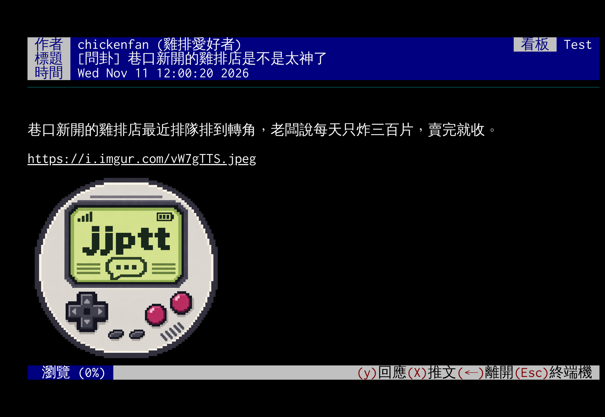
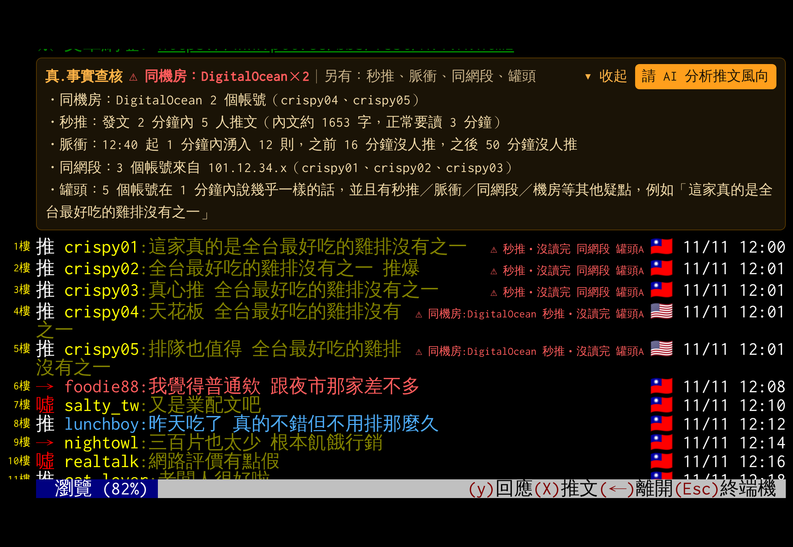
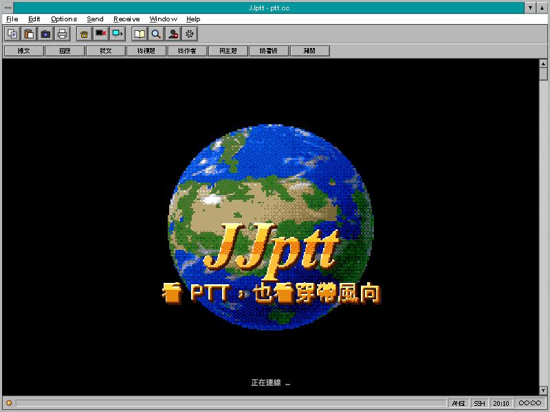
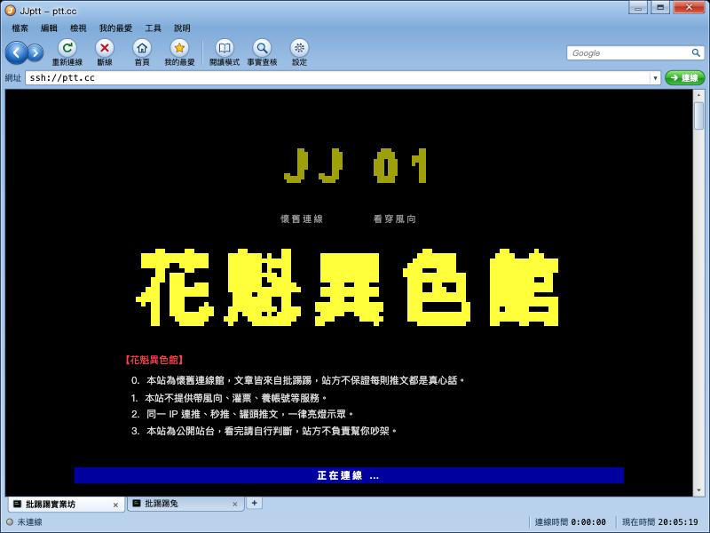

# JJptt

**中文** | [English](README.en.md) | [日本語](README.ja.md)

[](https://github.com/JJptt1980/JJptt/releases/tag/android-stable) [](docs/desktop.md) [](https://ko-fi.com/jjptt1980) [](https://www.facebook.com/profile.php?id=61596622202223)

**JJptt 是用來看 PTT 的免費工具。** 它讓 PTT 的文章更好讀，也會把「可能有人在帶風向」的跡象標出來給你看。

> PTT 是台灣很大的網路論壇。文章底下的留言叫「推文」。
> 「帶風向」是指一群人刻意用大量留言，讓大家以為某個看法是多數人的意見。

<a name="下載安裝"></a>

## 我該裝哪一個？

| 你用的是 | 裝這個 | 難不難 |
|---|---|---|
| **Android 手機** | [Android App](docs/android.md) | 簡單：下載一個檔案，打開就能裝 |
| **電腦**（Chrome、Edge、Brave、Arc、Vivaldi 瀏覽器） | [Chrome 擴充功能版](docs/desktop.md) | 要照步驟做一次，大約 5 分鐘 |
| **iPhone** | 還沒有，[原因和怎麼幫忙](docs/android.md#關於-ios-版) | |

<a name="說明文件"></a>

## 📚 說明文件：照這個順序讀


1. **先決定裝哪一個**：看上面「我該裝哪一個？」那張表。
2. **照說明裝好、開始用**
   - 手機：[Android App](docs/android.md)：下載、安裝、更新、App 能做什麼。
   - 電腦：[Chrome 擴充功能版](docs/desktop.md)：一步一步安裝、第一次使用、怎麼更新、遇到問題怎麼辦。
3. **看到推文旁邊有「秒推」「同網段」這些標記，想知道是什麼意思**：[FACT 說明](docs/fact.md)。建議先讀最前面的「先說清楚」和「名詞小辭典」。
4. **要換手機、換電腦，或想備份設定**：[把設定搬到另一台](docs/settings-file.md)。
5. **App 裡找不到看信、修改文章這些 PTT 功能**：[PTT 有、但 JJptt 還沒做的功能](docs/missing-features.md)，每一項都寫了現在可以怎麼辦。
6. **想知道最近改了什麼**：[更新紀錄](CHANGELOG.md)。
7. **想收到新版通知、看功能介紹**：追蹤 [JJptt 的 Facebook 粉絲專頁](https://www.facebook.com/profile.php?id=61596622202223)，每次正式版更新都會在那裡說明。

## PTT 上誰在帶風向？JJptt 讓你一眼看穿。

有時候，一篇文章底下好像大家都同意，其實是少數幾個人約好一起留言。例如：

- 一分鐘內，五個帳號說了幾乎一樣的話。
- 好幾個帳號從同一個地方上網。（每台上網的裝置都有一個「IP」，就像網路上的門牌號碼。門牌很接近，可能是同一群人。）
- 留言的人是從國外的「機房」上網。一般人很少這樣，這常是為了藏住自己真正的位置。

這些靠眼睛很難發現。JJptt 會直接標在推文旁邊。

<p align="center">
  
  
</p>

**免費、沒有廣告、不收集任何資料。** 程式碼全部公開（開源），誰都可以檢查。

### 為什麼選 JJptt

| | |
|---|---|
| 🔍 **[抓帶風向](docs/fact.md)** | 自動標出可疑的推文：推得太快、一大群同時湧進、說一樣的話、從同一個地方或機房上網。不用自己數 |
| 🤖 **不信我？去問 AI** | JJptt 只把疑點標出來，信不信由你。不放心，整篇文章一鍵丟給 ChatGPT、Claude 等 AI 自己問；也可以只選一段文字，問「這是不是事實？」 |
| 🖼️ **看圖神器** | Beauty 這種圖很多的看板，圖片直接排在文章裡，不用一張一張點開。下一篇連圖一起先載好，翻頁不用等 |
| 🔒 **不經過別人** | 直接連到 PTT，中間沒有別人的伺服器。帳號密碼只存在你自己的電腦或手機 |
| 👍 **單手翻頁** | Android App 的上一篇／下一篇可以做成浮在螢幕左邊或右邊的小按鈕，拇指按得到，一隻手就能一路看下去（設定 → 版面 → 內文 →「上一篇／回列表／下一篇 放在哪」，左右可以都開） |
| 📖 **好讀** | 圖片、影片、新聞直接顯示在文章裡。下一篇先幫你讀好，點了馬上開 |
| 🎨 **推文一目了然** | 樓層、國旗、同一個人推了幾次，都用顏色標出來。不想看的人可以加進黑名單，讓他變淡或隱藏 |
| 🕹️ **復古之幽情** | 擴充功能版可以換成仿 NetTerm、仿 柯柯人（KKMan）的老視窗，連線時跳出 256 色地球或「花魁異色館」點陣大字，一秒回到撥接上 BBS 的年代（[看圖](#retro)） |
| 🔄 **設定帶著走** | 電腦上的設定可以搬到手機。手機調好的版面可以變成一串「碼」，分享給朋友 |

## 📱 Android App

> **想了解 Android App？** 下載就能用，不用另外裝東西。可以推文、回文、發文；選一段文字就能問 AI；密碼用手機內建的保險箱加密。免費，約 10 MB。
>
> 👉 **[Android App 介紹與下載](docs/android.md)**：截圖、下載與更新、iPhone 版的計畫

## 💻 Chrome 擴充功能版

「擴充功能」是裝在瀏覽器裡的小工具。JJptt 保留 PTT 原本的樣子（黑底、整齊的字），再加上好讀的「閱讀模式」和事實查核。Chrome、Edge、Brave、Arc、Vivaldi 都能用。





- **閱讀模式**：圖片、影片、新聞夾在文章裡；下一篇先幫你讀好。
- **越用越順手**：最新的文章排最上面；選一段文字就能問 AI。
- **設定帶著走**：可以和 Google 帳號同步，也可以存成檔案；有新版時按一下就會自己更新。

<a name="retro"></a>

### 🕹️ 復古視窗風格：回到撥接上網的那個年代

還記得數據機「嗶——嘰——」的撥接聲、半夜偷偷上 BBS、等一張圖要等好幾分鐘的日子嗎？JJptt 擴充功能版可以把畫面換成當年的樣子：

- **仿 NetTerm**：Windows 3.1 的灰色視窗、藍綠色標題列、一排立體小按鈕，連線時先出現一顆顆粒粗粗的 256 色地球。
- **仿 柯柯人**：Windows 7 的玻璃視窗、圓圓亮亮的按鈕、網址列寫著 `telnet://ptt.cc`、下面一排站台分頁，狀態列算著「連線時間」。連線時先看到「花魁異色館」的黃色點陣大字進站畫面。

畫面是舊的，功能還是新的：閱讀模式、事實查核照樣都能用。

**怎麼開：** 設定 → 版面 → 介面 → 視窗風格，選「仿 NetTerm」或「仿 柯柯人」。想換回來就選「原本（全黑）」。

| 仿 NetTerm | 仿 柯柯人 |
|---|---|
|  |  |

<sub>※ 只有外觀：外框上的按鈕和選單現在按了只會顯示「施工中」，要操作請照平常用鍵盤。Android App 沒有這個設定。</sub>

<sub>※ **NetTerm**：1990 年代的 Windows 連線軟體，那時很多人第一次上 BBS 就是用它。</sub><br>
<sub>※ **KKMan**（這裡叫「柯柯人」）：2000 年前後台灣很紅的瀏覽器，用 IE 的核心，內建 BBS 連線和分頁，可以一邊開網頁一邊掛在 BBS 上。</sub><br>
<sub>※ **花魁異色館**：KKCITY BBS 時代的老站台，進站時那種滿版的黃色點陣大字，是很多人的共同回憶。</sub><br>
<sub>※ 這些名字只是用來說明「長得像什麼」，跟原本的軟體和站台沒有關係；畫面上的圖示和圖案都是 JJptt 自己畫的。</sub>

**[擴充功能版安裝與使用說明](docs/desktop.md)**

<sub>以上畫面都是示範，文章、帳號與 IP 都是虛構的。</sub>

## FACT 真.事實查核

**FACT = Facts, Accuracy, Credibility & Truth（事實、準確、可信、真相）。** 證據勝於立場：不問立場，只問事實。

- **被標記不等於網軍。** 標記只代表「這個行為符合某條規則」，判斷留給你。
- **同一把尺**：不管政治立場、是誰、屬於哪個團體，標準都一樣。
- **證據公開**：每個標記都說得出為什麼，點開報告就看得到。
- **可以更正**：標錯了可以一鍵移除，每條規則都能自己開關、調整。自動加入黑名單的人都有紀錄，可以回頭檢查有沒有抓錯。
- **不信我的查核？去問 AI。** 每篇文章、每段文字都能一鍵交給 AI，讓另一個角度來檢查。


👉 **[FACT 說明](docs/fact.md)**：每個標記是什麼意思、為什麼可疑、被自動加進黑名單的規則、標錯了怎麼辦

## 流量提醒

閱讀模式會下載文章裡的圖片，比較耗流量。用手機熱點或流量有限時，可以在設定裡關掉「預先讀取時連圖片一起下載」。詳細的數字和省流量的方法：[擴充功能版說明的「流量」](docs/desktop.md#流量)。

<!-- 舊網址的段落連結（安裝教學、常見問題…）跳到這裡：那些內容搬到 docs/desktop.md -->
<a name="安裝教學約-5-分鐘只要做一次"></a><a name="mac"></a><a name="windows"></a><a name="第一次使用"></a><a name="怎麼更新"></a><a name="常見問題"></a><a name="為什麼要有閱讀模式"></a><a name="進階給會寫程式的人"></a><a name="網站版需要自己部署轉接站"></a><a name="自己-fork-時的-google-同步設定"></a><a name="android-app"></a>

安裝教學、第一次使用、怎麼更新、常見問題、為什麼要有閱讀模式，都在 [擴充功能版說明](docs/desktop.md)。

## 問題回報

用起來有問題、看到奇怪的畫面，或想要什麼新功能，都可以到 [JJptt 的 Facebook 粉絲專頁](https://www.facebook.com/1466948699840024) 留言或私訊反應。回報時寫上你用的是哪一版（Android App、擴充功能版或網頁版）、在哪個畫面、做了什麼，附上截圖會更快找到問題。

## 開發（寫程式的人才需要看）

JJptt fork 自 [iamchucky/PttChrome](https://github.com/iamchucky/PttChrome)（GPL-2.0）。原版要靠已停用的 Chrome App 開 TCP 連線；JJptt 的擴充功能版改用本機小程式直接連線，另外也有網頁版，透過自己的 Cloudflare Worker 轉接站（`worker/`）連到 PTT。兩種都預設走 SSH，加密在瀏覽器裡完成。

`dev.html` 直接載入 `js/` 的原始碼；`index.html` 和擴充功能用打包後的 `js/pttchrome.min.js`：

```bash
npm install
npm run build
```

`npm run build` 會打包網站並複製到 `extension/`。發佈新版本：在 `js/changelog.js` 最上面加一筆（版本號、日期、改了什麼），再 `npm run build`，版本號會自動寫進 `package.json`、`extension/manifest.json` 和 `CHANGELOG.md`。

`npm test` 跑自動測試（只要 Node，不用另外裝套件），測試在 `test/run.js`：事實查核的連推規則、臨時黑名單、同網址洗版，以及每條規則在設定頁和中英文說明都有沒有漏掉。

Android App 在 `mobile/`（Capacitor）；在那裡 `npm run build` 會把打包好的網頁複製進 App。每次推到 `mobile` 分支，CI 會自動建置並簽章（`.github/workflows/android.yml`），測試過的版本再手動發成正式版（`.github/workflows/android-stable.yml`）。

本機小程式的原始碼在 `native-host/main.go`，改完用 `sh native-host/build.sh` 重新編譯所有平台的執行檔（需要 Go）。

## 資料來源（寫程式的人才需要看）

IP 國籍資料（`data/geoip-v4.bin`）由 [ip-location-db](https://github.com/sapics/ip-location-db) 的 geo-whois-asn-country 轉換而來，資料授權為 [CC BY 4.0](https://creativecommons.org/licenses/by/4.0/)，來源：[Number Resource Organization (NRO)](https://www.nro.net/)。更新方式見 `tools/build-geoip.js`。

機房／VPN IP 資料（`data/hosting-v4.bin`）由 ip-location-db 的 origin-asn 篩選而來，資料為 [PDDL](https://opendatacommons.org/licenses/pddl/1-0/)（公有領域），來源為各區域網路註冊機構與 Route Views / RIPE RIS 的公開路由資料。更新方式見 `tools/build-hosting.js`。

## 致謝

感謝中正機械 MBA91 几啟成，我的 MUSE。
